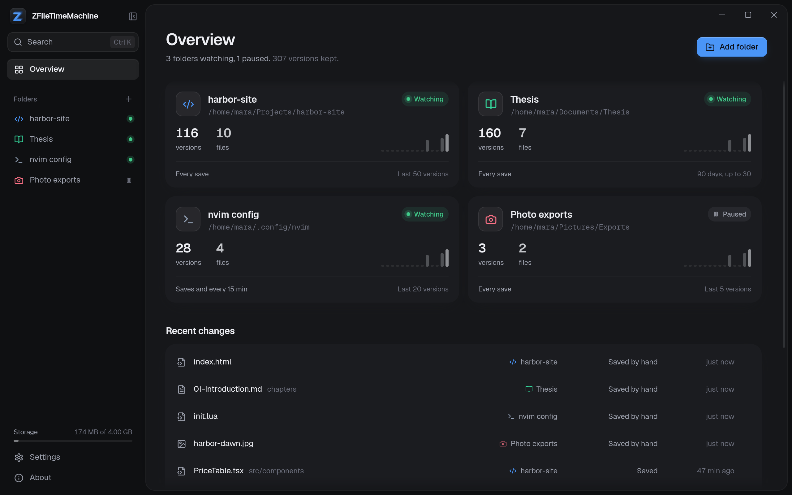
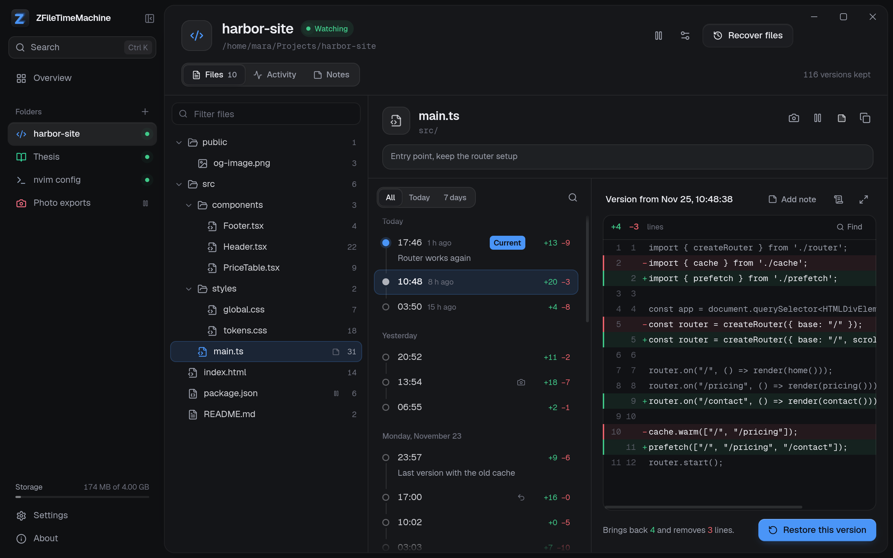
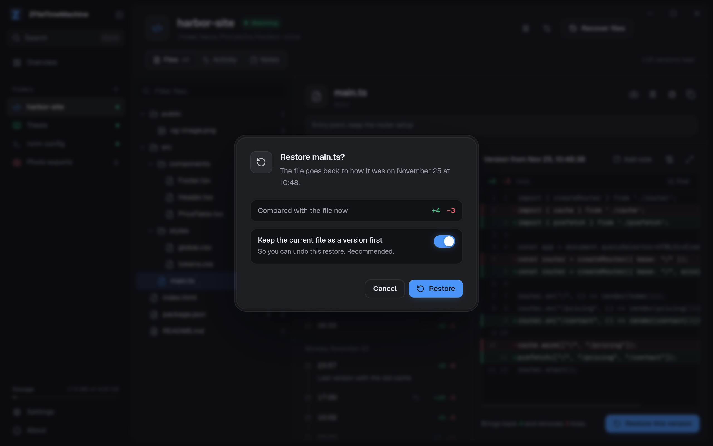
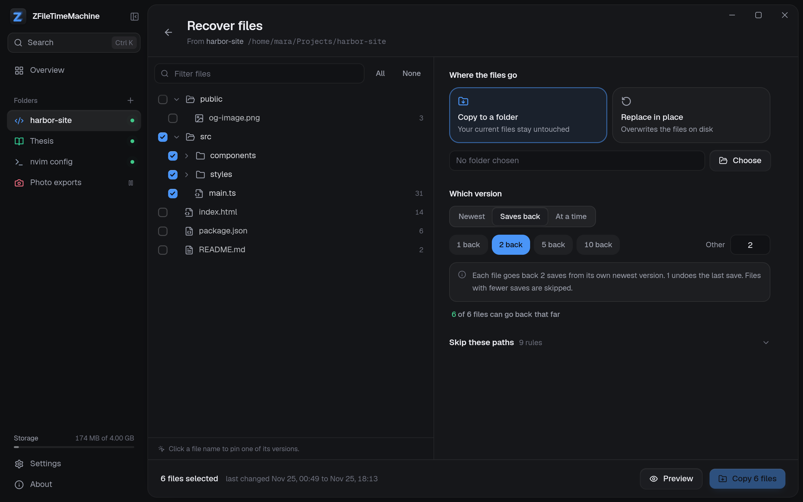
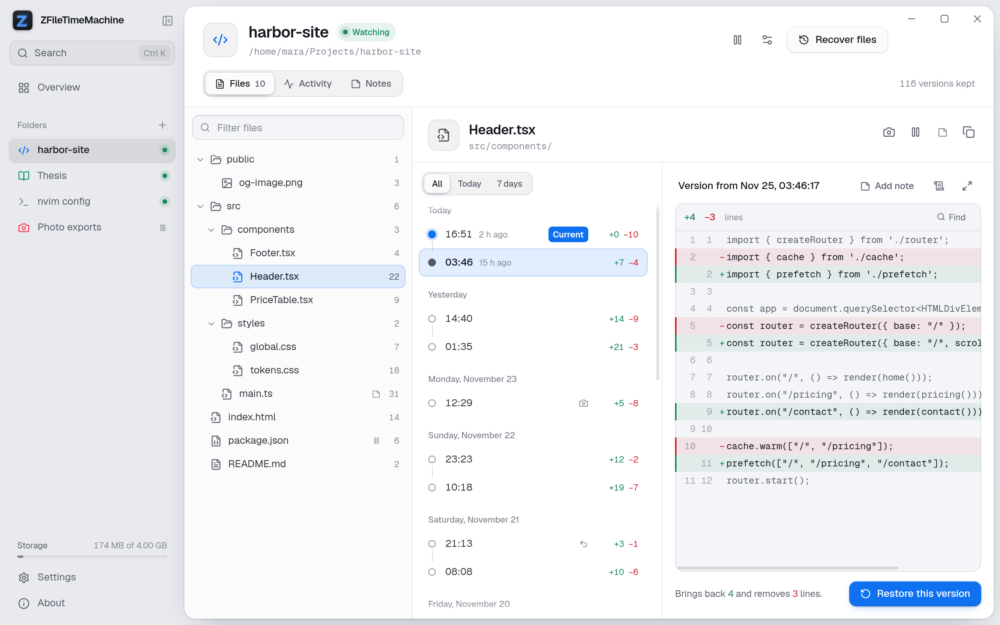

<div align="center">


# ZFileTimeMachine

**A local, private, automatic version history for any folder on your computer.**

*Think of it as Time Machine for individual files — but lighter, faster, and entirely yours.*

[](https://www.gnu.org/licenses/gpl-3.0)
[](https://tauri.app)
[](https://react.dev)
[](https://www.rust-lang.org)
[](CHANGELOG.md)
[](#platform-support)
[](https://zsync.eu/zftm/)

**[Download prebuilt binaries for Linux, Windows & macOS → zsync.eu/zftm/](https://zsync.eu/zftm/)**

</div>

---

## What is ZFileTimeMachine?

ZFileTimeMachine watches folders you choose and **automatically saves a copy of every file every time it changes**. At any moment you can scroll back through a file's history, see exactly what changed between versions, and restore any version instantly — with a single click.

No cloud. No git. No command line. Just your files, safely versioned, on your own machine.

> [!NOTE]
> This is **not** a backup tool in the traditional sense. It does not copy files to an external drive or upload them anywhere. It is a **local version history system** — it keeps a record of every version of your files so you can go back in time whenever you need to.

---

## What's new in 0.3.0

- **A completely new interface.** Your folders live in a sidebar, and a folder opens as a file tree next to the file's history. Versions are grouped by day and show how many lines each one added and removed. The comparison sits right beside the list, with unchanged stretches folded away, and one button restores the version you're looking at.
- **Image previews.** For pictures, a version is shown next to the file as it is now.
- **Find any file** with `Ctrl K` / `⌘ K`, across every watched folder.
- **Choose what to watch, file by file.** When you add a folder, its contents show up as a tree. Untick whatever you don't want versions of.
- **Themes.** Seven themes for dark and light, any accent color you like (folder icons follow it, or get their own color), and corners from sharp to round.
- **More control per folder.** Choose when versions are saved (every save, every save plus a schedule, or only by hand) and how long they're kept (a number of versions, a number of days, or both).
- **Native window material** on macOS (translucent sidebar) and Windows 11 (Mica).
- Smooth, restrained motion throughout, which steps aside if your system asks for reduced motion.

### 0.2.1

- **The app never snapshots its own data.** Fixes [#2](https://github.com/TheHolyOneZ/ZFileTimeMachine/issues/2), where watching a folder that contains ZFileTimeMachine's data folder (such as `~/Library/Application Support` on macOS) made it snapshot its own snapshots without end. That folder is now always skipped, and files from it that were already tracked are cleaned up on the next start.
- **Folder ignore rules work on live changes.** Rules like `Cache/` or `node_modules/` used to apply only to the first scan. Every later change inside those folders is now skipped too.
- **Paused subfolders stay paused.** New files in a paused subfolder are added as paused instead of being snapshotted.

### 0.2.0

- **Restored files stay in the list.** Fixes [#1](https://github.com/TheHolyOneZ/ZFileTimeMachine/issues/1), where rewinding a file on Windows made it vanish from the monitored files. Also fixes copies being mistaken for renames, and the timeline's "Current" marker after a rewind.
- **A fresh look** with a custom title bar, built-in search (`Ctrl K` / `⌘ K`), new typography, and a reworked light theme. Navigation is exactly where it was.

See the full [changelog](CHANGELOG.md).

---

## Screenshots

| Overview | A file's history |
|---|---|
|  |  |
| **Restoring a version** | **Recovering many files** |
|  |  |

<details>
<summary>Light theme</summary>



</details>

---

## Why Was It Made?

Every developer, writer, or power user has had this moment: you made a change, saved the file, and then realized the old version was exactly what you needed. You hit Ctrl+Z — too late, the session is gone. You check git — you never committed it. You look in Recycle Bin — nothing there.

**ZFileTimeMachine was built for exactly that moment.**

It was also built because existing solutions all require a compromise:

- **Git** is incredible but requires learning, intentional commits, and a command line
- **Cloud services** (Dropbox, Google Drive history) lock your data to their servers and subscription fees
- **System snapshots** (Time Machine, VSS) operate at a disk level — slow, large, inflexible
- **Manual backups** only work if you actually remember to do them

ZFileTimeMachine sits in a gap nothing else fills: **automatic, per-file, local, zero-friction version history** that just runs silently in the background.

---

## Who Is It For?

<table>
<tr>
<td width="50%">

**You'll love this if you...**
- Write code, documents, or creative work and hate losing progress
- Work on projects that aren't in git (scripts, configs, drafts)
- Want a safety net before running risky commands or refactors
- Collaborate on a shared machine or folder
- Have ever accidentally overwritten a file you needed

</td>
<td width="50%">

**Especially useful for...**
- Developers watching `src/` folders for pre-commit safety
- Writers versioning Markdown, LaTeX, or plain text files
- Designers protecting project files (Figma exports, PSD, AI)
- System admins tracking config file changes
- Researchers preserving data processing scripts

</td>
</tr>
</table>

---

## Core Strengths

> [!TIP]
> These are the things ZFileTimeMachine does exceptionally well — not features bolted on, but design decisions baked in from the beginning.

| Strength | What it means for you |
|---|---|
| **100% Local & Private** | Your files never leave your machine. There is no account, no sync, no telemetry, no internet required. |
| **Zero Friction** | Add a folder, walk away. Everything else is automatic. You don't think about it until you need it. |
| **Smart Deduplication** | If ten files share the same content, only one copy is stored. Large projects with many similar files stay lean on disk. |
| **Safe Rewinding** | Before restoring any file, the app automatically saves its current state first. You can always undo the undo. |
| **Surgical Control** | Restore one specific file, or all 200 at once. Target the latest version, Nth from latest, or any exact point in time. |
| **Binary-Aware** | Images, compiled outputs, and binary files are handled separately — tracked but not diffed, with configurable storage limits. |
| **Lightweight Backend** | Built in Rust. The background watcher uses almost no CPU or RAM even on large folders with thousands of files. |

---

## Features

### Automatic Snapshots

ZFileTimeMachine watches your folder continuously. When a file changes, it captures a snapshot. You choose how this works per folder, in its settings under **Versions**:

- **Every save** *(default)*: a snapshot a moment after each save. Several saves in quick succession count as one, and you set how long that moment is.
- **Every save and on a schedule**: the same, plus a check of the whole folder every few minutes that catches any change a save event missed.
- **Only by hand**: nothing is saved automatically. Use the camera button on a file.

You can also limit how often one file gets a snapshot (useful when a formatter rewrites the same file many times in a row).

> [!IMPORTANT]
> Snapshots are not copies of your entire folder. The app uses a **content-addressed store** — only the unique content of each changed file is saved, deduplicated by hash. Two files with identical content take up space only once. This keeps storage usage surprisingly small even across hundreds of versions.

---

### File History & Comparison

Every tracked file has a **full history** of every version ever saved, grouped by day. For each version you see:

- **How much changed**: the lines it added and removed compared with the version before it
- **When**: the time, and how long ago for today's versions
- **How it was captured**: small icons mark versions saved by hand, on a schedule, or kept before a restore
- **Your notes**: attach a personal note to any version
- Which version matches the file on disk, marked **Current**

Select a version and the comparison with the file as it is now appears beside the list. Unchanged stretches are folded so the changes come first (or turn on **Always show the whole file**), and `Ctrl F` searches the comparison (regular expressions work too). Pictures are shown side by side instead: the version next to the file now.

---

### One-Click Restore

Found the version you need? Click **Restore this version** (or double-click it, or press `Enter`). The app:

1. Shows how many lines will come back and go away
2. Optionally saves your current file as a new snapshot first *(on by default, so you can undo the restore)*
3. Atomically replaces the file with the chosen version and verifies the write was successful

> [!CAUTION]
> When **Restore in Place** is used, the current file is overwritten. The app automatically creates a `pre-rewind` snapshot before writing, but make sure you understand what you're restoring before confirming — especially when restoring multiple files at once.

---

### Bulk Recovery

Lost multiple files at once? Bad refactor that touched 80 files? Accidentally deleted a whole folder?

The **Recover Folder** screen lets you:

- Browse and select any combination of files from a visual checkbox tree
- Choose a **snapshot point**: latest version, Nth from latest, or any specific date and time
- Choose a **destination**: export to a new folder *(completely safe, non-destructive)* or restore in place *(replaces current files)*
- **Preview first** — run a dry run to see exactly what would be written before anything is touched
- Handle conflicts — skip existing destination files or overwrite them
- Recover soft-deleted files — if a file was deleted from the watched folder but snapshots exist, it can be restored
- Filter with ignore patterns — recover everything except `node_modules/`, `target/`, etc.

> [!NOTE]
> Export mode is completely non-destructive. It copies snapshot content to a new location and never touches your original files. When in doubt, always export first.

---

### Notes & Search

Attach plain-text notes to any **file** or any **snapshot**:

- *"This was working before the refactor"*
- *"Version sent to client on Monday"*
- *"Broke everything — pinning this as reference"*

All notes are **full-text searchable** from the folder view. Click a search result to jump directly to the file or the exact snapshot that matches.

---

### Retention Rules

You control how many snapshots are kept per folder, so your storage doesn't grow forever:

| Rule | How it works |
|---|---|
| **Keep Last N** | Always keep the most recent N snapshots per file |
| **Time-Based** | Keep all snapshots from the last X days |
| **Both** | Keep at most N snapshots per file, and none older than X days |

Old snapshots are cleaned up automatically. The deduplication store is garbage-collected so freed snapshots actually free disk space.

---

### Binary File Support

ZFileTimeMachine tracks binary files (images, compiled outputs, archives) with smart limits:

- Configurable **maximum size** per binary file (default: 50 MB)
- Configurable **maximum copies** kept (default: 3 most recent)
- Binary files appear in the history but there's no line comparison (images get a side-by-side preview instead), and you can still restore them
- Files exceeding your size limit are tracked in the database but not snapshotted

---

### Pause, Resume, and Soft Delete

- **Pause a folder** — temporarily stop watching without losing any history. Useful when doing a large batch operation you don't want versioned.
- **Resume** — the watcher picks up exactly where it left off
- **Remove a folder** — soft-deleted for 7 days so you can reconsider; then permanently removed. Your original files are untouched.

---

### Storage Stats & Health

The **Settings** screen shows you exactly what is happening with your storage:

- Total physical storage used (after deduplication)
- Logical size vs. physical size (how much space deduplication is saving you)
- Per-file storage breakdown for any folder
- A built-in **integrity checker** to verify your snapshot database is healthy
- A **self-test** that checks every setting against real files in a temporary folder

---

### Ignore Rules

Tell ZFileTimeMachine what to skip, using the same gitignore syntax you already know:

```
node_modules/
target/
.git/
dist/
*.log
*.tmp
__pycache__/
.DS_Store
```

You rarely need to write rules by hand: the tree you see when adding a folder, and later in its settings under **What to watch**, writes them for you as you untick folders and files.

Rules are per-folder and editable at any time through the settings UI. The app ships with sensible defaults so you don't have to think about it for common project types.

A rule ending in `/` skips that folder and everything inside it. Without another `/` it matches at any depth (`Cache/` skips every folder named `Cache`); with one it is relative to the watched folder (`SomeApp/cache/`).

ZFileTimeMachine's own data folder is always skipped, so you can safely watch a folder that contains it, such as `~/Library/Application Support` on macOS or `%LOCALAPPDATA%` on Windows. No rule is needed. The app's data folder itself can't be added as a watched folder.

---

### Per-File Overrides

For files you never want auto-snapshotted (build artifacts, lock files, frequently-regenerated outputs), use the **pause button** in the file's header or right-click it in the file tree to switch it to **Manual only** mode. The file stays tracked in the database but snapshots only happen when you explicitly ask.

You can do the same for a whole subfolder by right-clicking it in the file tree. Files added to a paused subfolder later are paused as well: they appear in the list without a snapshot, and you can still snapshot them by hand.

---

## The Interface

### Sidebar

Every watched folder is listed in the sidebar, with a dot while it's being watched and a pause sign when it isn't. Below them sit the storage meter, Settings and About. Collapse the sidebar with `Ctrl B` (`⌘ B`); it also narrows by itself in small windows. Drop a folder anywhere on the window to start watching it.

### Overview

All watched folders as cards: how many versions and files each one has, two weeks of activity, how it saves and how long it keeps versions. Below them, the most recent changes across all folders, each one a click away from its file's history.

### Search

Press `Ctrl K` (`⌘ K` on macOS) or click **Search** in the sidebar to find any file in any watched folder, jump to a folder or screen, or run an action like switching the theme.

### Folder

The main work area for a folder:
- A file tree you can filter, fold, and move through with the arrow keys
- The selected file's history, with the comparison beside it and a button to restore
- **Activity**: everything that happened in the folder, by day
- **Notes**: search the notes on files and versions, and jump to the match

### Recover

The bulk recovery screen:
- File tree with checkboxes: select individual files or entire directories at once
- Where the files go: copy them to another folder, or replace them in place
- Which version: the newest, a number of saves back, or the version at a point in time
- Pin a specific version for any single file
- Paths to skip
- A preview of exactly what would be recovered before anything is written, and progress while it runs

### Folder Settings

Per folder:
- Name, icon and color, or a preset for code, writing or media
- When versions are saved, how long to wait after a save, and how often one file can get a new version
- How long versions are kept (a number, a number of days, or both)
- Binary file size limit, compression, and how deep into subfolders to watch
- What to watch: the folder as a tree to tick and untick, and the full list of rules
- Space used per file

### Settings

App-wide:
- Appearance: dark, light or like your system, seven themes, accent color, folder icon colors, corner roundness, and whether comparisons always show the whole file
- What closing the window does (keep running in the tray, or quit), and starting with your computer
- An optional limit on the total space for history, with deduplication stats
- Free unused space, remove empty file entries, and check the history for damage
- The self-test

---

## Project Layout

```
ZFileTimeMachine/
├── src/                          # React + TypeScript frontend
│   ├── assets/logo.png
│   ├── components/
│   │   ├── shell/                # Sidebar and window controls
│   │   ├── ui/                   # Buttons, sheets, popovers, segmented controls, tooltips
│   │   ├── reactbits/            # Text animation from React Bits
│   │   ├── FileTree.tsx  HistoryPane.tsx  DiffViewer.tsx  FolderCard.tsx
│   │   ├── RecoverTree.tsx  RecoverConfirmDialog.tsx  ConfirmDialog.tsx
│   │   ├── CommandPalette.tsx  ContextMenu.tsx  KeyboardShortcuts.tsx
│   │   ├── ActivityFeed.tsx  NoteEditor.tsx  IgnoreRulesEditor.tsx
│   │   ├── AddFolderDialog.tsx  OnboardingModal.tsx  DevPanel.tsx
│   │   └── …                     # small UI pieces (tooltips, checkboxes, pickers)
│   ├── context/                  # Toasts, onboarding, adding folders
│   ├── hooks/                    # React Query hooks and live backend events
│   ├── lib/                      # Tauri command bindings, types, events, motion, platform helpers
│   ├── routes/                   # Overview, FolderDetail, FolderRecover, Settings, About
│   ├── App.tsx  main.tsx  index.css
├── src-tauri/                    # Rust backend
│   ├── capabilities/default.json # Permissions granted to the window
│   ├── icons/
│   ├── src/
│   │   ├── commands/             # Tauri commands: folders, snapshots, rewind, recover, settings, notes, appearance, browse, dev
│   │   ├── db/                   # SQLite schema, migrations, queries
│   │   ├── snapshot/             # Hashing, binary detection, retention
│   │   ├── store/cas.rs          # Content-addressed blob store
│   │   ├── watcher/              # File watcher supervisor, ignore rules, debounce
│   │   ├── util/fs.rs            # Atomic, verified file writes
│   │   ├── rename.rs  diff.rs  events.rs  config.rs  error.rs
│   │   └── lib.rs  main.rs
│   ├── tauri.conf.json           # App and window config (all platforms)
│   ├── tauri.macos.conf.json     # macOS overrides (native traffic lights, translucent window)
│   ├── tauri.windows.conf.json   # Windows overrides (transparent window for Mica)
│   └── Cargo.toml
├── docs/                         # README screenshots
├── CHANGELOG.md
├── package.json  pnpm-lock.yaml  vite.config.ts  tailwind.config.ts
└── README.md
```


---

## Platform Support

| Platform | Status | Notes |
|---|---|---|
| **Linux** | Supported | Primary development platform. File watching via inotify. |
| **Windows** | Supported | Windows 10 and 11. On Windows 11 the window has rounded corners and the Mica material behind the sidebar. File watching via ReadDirectoryChangesW. |
| **macOS** | Builds, not fully tested | Apple Silicon and Intel builds are produced. The sidebar uses the native translucent material. The app shows a notice on first launch; please [report issues](https://github.com/TheHolyOneZ/ZFileTimeMachine/issues). File watching via FSEvents. |

---

## Where Your Data Lives

ZFileTimeMachine stores everything locally on your machine:

| Platform | Location |
|---|---|
| **Linux** | `~/.local/share/zfiletimemachine/` |
| **macOS** | `~/Library/Application Support/com.zfiletimemachine.ZFileTimeMachine/` |
| **Windows** | `%LOCALAPPDATA%\zfiletimemachine\ZFileTimeMachine\data\` |

Inside that folder:

```
zfiletimemachine/
├── db.sqlite        # All metadata: folders, files, snapshots, notes
├── activity.log     # Human-readable chronological event log
└── cas/             # Content blobs, deduplicated by SHA-256 hash
    ├── 73/          # Sharded by the first two bytes of the hash
    │   └── be/
    │       └── 73be6e8f…     # Named by its full hash; each unique content is stored once
    └── ...
```

ZFileTimeMachine never snapshots this folder, even when it sits inside a folder you watch.

> [!WARNING]
> Deleting this folder removes all your snapshot history permanently. Your original files in the watched folders are completely untouched — but every saved version will be gone.

---

## Building from Source

> [!NOTE]
> **Prebuilt releases for Linux, Windows, and macOS are available at [zsync.eu/zftm/](https://zsync.eu/zftm/) — no build steps needed.** The section below is for developers who want to build from source.

**Prerequisites:**
- [Node.js 20+](https://nodejs.org) and [pnpm](https://pnpm.io)
- [Rust stable toolchain](https://rustup.rs)
- Tauri system dependencies for your platform — [see Tauri prerequisites](https://tauri.app/start/prerequisites/)

```bash
# Install frontend dependencies
pnpm install

# Run in development mode with hot reload
pnpm tauri dev

# Build a production release package
pnpm tauri build

# Run the backend test suite
cd src-tauri && cargo test

# Type-check and lint the frontend
pnpm check
```

---

## Keyboard Shortcuts

| Shortcut | Action |
|---|---|
| `Ctrl / Cmd + K` | Search files, folders and actions |
| `Ctrl / Cmd + B` | Show or hide the sidebar |
| `↑` `↓` | Move through files and versions |
| `Enter` | Restore the selected version |
| `Ctrl / Cmd + F` | Find in a comparison |
| `Ctrl / Cmd + Enter` | Save a note |
| `Ctrl / Cmd + S` | Save changed settings |
| `Ctrl / Cmd + A` | Select every file on the Recover screen |
| `Escape` | Close a dialog or menu |
| `?` | Show the shortcut list |

---|---|
| `Ctrl / Cmd + K` | Open command palette |
| `?` | Show keyboard shortcuts reference |
| `Escape` | Close modal / clear selection |
| `Space` | Toggle file selection in recovery tree |
| `Shift + Click` | Range-select files in recovery tree |
| `Ctrl / Cmd + A` | Select all visible files in recovery tree |
| `Enter` | Confirm / submit in recovery screen |

---

## Tech Stack

<details>
<summary>Technical details (click to expand)</summary>

**Frontend**
- React 18 + TypeScript 5 (strict mode)
- Vite 5 (build tool and dev server)
- Tailwind CSS 3 (utility-first styling)
- React Query 5 / TanStack Query (server state, caching, background refetch)
- TanStack Virtual (smooth file trees with thousands of files)
- GSAP (motion: easing, sliding highlights, the restore animation) and React Bits text effects
- Lucide React (icon library)
- date-fns (date formatting)
- Geist and Geist Mono (bundled typefaces, no network needed)

**Backend (Rust)**
- Tauri 2 (cross-platform desktop app framework, IPC bridge)
- notify 6 + notify-debouncer-full (file system watching — inotify on Linux, FSEvents on macOS, ReadDirectoryChangesW on Windows)
- rusqlite (embedded SQLite database)
- sha2 (SHA-256 content hashing for deduplication)
- similar (line-level diff algorithm)
- ignore 0.4 (gitignore-style glob pattern matching)
- zstd 0.13 (optional blob compression)
- tokio 1 (async runtime and thread coordination)
- serde / serde_json (serialization between Rust and TypeScript)
- tracing + tracing-subscriber (structured logging)

**Storage model**
- SQLite for all metadata (folders, files, snapshots, notes, activity log)
- Custom content-addressed blob store (CAS) for file contents
- SHA-256 hash as the global deduplication key — identical content stored only once across all folders and versions

</details>

---

## License

```
ZFileTimeMachine
Copyright (C) 2026  TheHolyOneZ

This program is free software: you can redistribute it and/or modify
it under the terms of the GNU General Public License as published by
the Free Software Foundation, either version 3 of the License, or
(at your option) any later version.

This program is distributed in the hope that it will be useful,
but WITHOUT ANY WARRANTY; without even the implied warranty of
MERCHANTABILITY or FITNESS FOR A PARTICULAR PURPOSE. See the
GNU General Public License for more details.

You should have received a copy of the GNU General Public License
along with this program. If not, see <https://www.gnu.org/licenses/>.
```

**GPL-3.0** — Free and open source. You are free to use, study, modify, and distribute this software under the terms of the GNU General Public License v3. Any modified versions you distribute must also be released under GPL-3.0.

---

<div align="center">

Made with care by **TheHolyOneZ**

*"An undo button for your filesystem."*

**[Download → zsync.eu/zftm/](https://zsync.eu/zftm/)**

</div>
