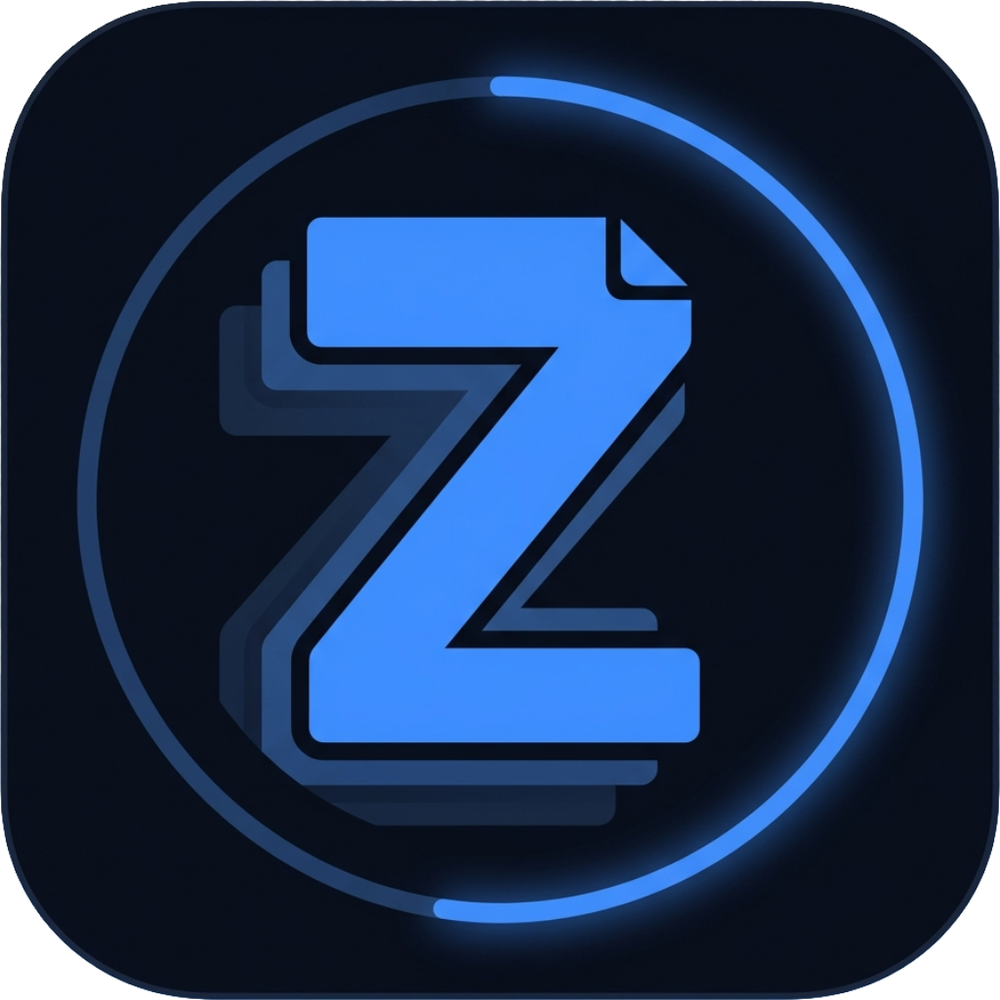

<div align="center">



# ZFileTimeMachine

**A local, private, automatic version history for any folder on your computer.**

*Think of it as Time Machine for individual files — but lighter, faster, and entirely yours.*

[](https://www.gnu.org/licenses/gpl-3.0)
[](https://tauri.app)
[](https://react.dev)
[](https://www.rust-lang.org)
[](https://zsync.eu/zftm/)

**[Download prebuilt binaries for Linux, Windows & macOS → zsync.eu/zftm/](https://zsync.eu/zftm/)**

</div>

---

## What is ZFileTimeMachine?

ZFileTimeMachine watches folders you choose and **automatically saves a copy of every file every time it changes**. At any moment you can scroll back through a file's history, see exactly what changed between versions, and restore any version instantly — with a single click.

No cloud. No git. No command line. Just your files, safely versioned, on your own machine.

> [!NOTE]
> This is **not** a backup tool in the traditional sense. It does not copy files to an external drive or upload them anywhere. It is a **local version history system** — it keeps a record of every version of your files so you can go back in time whenever you need to.

---

## Why Was It Made?

Every developer, writer, or power user has had this moment: you made a change, saved the file, and then realized the old version was exactly what you needed. You hit Ctrl+Z — too late, the session is gone. You check git — you never committed it. You look in Recycle Bin — nothing there.

**ZFileTimeMachine was built for exactly that moment.**

It was also built because existing solutions all require a compromise:

- **Git** is incredible but requires learning, intentional commits, and a command line
- **Cloud services** (Dropbox, Google Drive history) lock your data to their servers and subscription fees
- **System snapshots** (Time Machine, VSS) operate at a disk level — slow, large, inflexible
- **Manual backups** only work if you actually remember to do them

ZFileTimeMachine sits in a gap nothing else fills: **automatic, per-file, local, zero-friction version history** that just runs silently in the background.

---

## Who Is It For?

<table>
<tr>
<td width="50%">

**You'll love this if you...**
- Write code, documents, or creative work and hate losing progress
- Work on projects that aren't in git (scripts, configs, drafts)
- Want a safety net before running risky commands or refactors
- Collaborate on a shared machine or folder
- Have ever accidentally overwritten a file you needed

</td>
<td width="50%">

**Especially useful for...**
- Developers watching `src/` folders for pre-commit safety
- Writers versioning Markdown, LaTeX, or plain text files
- Designers protecting project files (Figma exports, PSD, AI)
- System admins tracking config file changes
- Researchers preserving data processing scripts

</td>
</tr>
</table>

---

## Core Strengths

> [!TIP]
> These are the things ZFileTimeMachine does exceptionally well — not features bolted on, but design decisions baked in from the beginning.

| Strength | What it means for you |
|---|---|
| **100% Local & Private** | Your files never leave your machine. There is no account, no sync, no telemetry, no internet required. |
| **Zero Friction** | Add a folder, walk away. Everything else is automatic. You don't think about it until you need it. |
| **Smart Deduplication** | If ten files share the same content, only one copy is stored. Large projects with many similar files stay lean on disk. |
| **Safe Rewinding** | Before restoring any file, the app automatically saves its current state first. You can always undo the undo. |
| **Surgical Control** | Restore one specific file, or all 200 at once. Target the latest version, Nth from latest, or any exact point in time. |
| **Binary-Aware** | Images, compiled outputs, and binary files are handled separately — tracked but not diffed, with configurable storage limits. |
| **Lightweight Backend** | Built in Rust. The background watcher uses almost no CPU or RAM even on large folders with thousands of files. |

---

## Features

### Automatic Snapshots

ZFileTimeMachine watches your folder continuously. When a file changes, it captures a snapshot. You choose how this works per folder:

- **On Change** — snapshot the moment a file is saved
- **Interval** — snapshot every X minutes, regardless of changes
- **Manual** — only when you click the camera icon yourself
- **Hybrid** *(recommended)* — debounce rapid changes AND take periodic checkpoints

> [!IMPORTANT]
> Snapshots are not copies of your entire folder. The app uses a **content-addressed store** — only the unique content of each changed file is saved, deduplicated by hash. Two files with identical content take up space only once. This keeps storage usage surprisingly small even across hundreds of versions.

---

### File Timeline & Diff Viewer

Every tracked file has a **full timeline** showing every version ever saved. Click any entry to see:

- **What changed** — a line-by-line diff (green = added, red = removed)
- **When it changed** — exact timestamp
- **How much it changed** — byte delta from the previous version
- **Why it was captured** — `change`, `interval`, `manual`, or `pre-rewind`
- **Your notes** — attach a personal note to any snapshot

The diff viewer supports **search** (including regex), so you can find exactly when a specific line was introduced, changed, or removed across the entire history of a file.

---

### One-Click Rewind

Found the version you need? Click **Rewind**. The app:

1. Shows you a full diff of exactly what will change
2. Optionally saves your current file as a new snapshot first *(so you can undo the rewind)*
3. Atomically replaces the file with the chosen version and verifies the write was successful

> [!CAUTION]
> When **Restore in Place** is used, the current file is overwritten. The app automatically creates a `pre-rewind` snapshot before writing, but make sure you understand what you're restoring before confirming — especially when restoring multiple files at once.

---

### Bulk Recovery

Lost multiple files at once? Bad refactor that touched 80 files? Accidentally deleted a whole folder?

The **Recover Folder** screen lets you:

- Browse and select any combination of files from a visual checkbox tree
- Choose a **snapshot point**: latest version, Nth from latest, or any specific date and time
- Choose a **destination**: export to a new folder *(completely safe, non-destructive)* or restore in place *(replaces current files)*
- **Preview first** — run a dry run to see exactly what would be written before anything is touched
- Handle conflicts — skip existing destination files or overwrite them
- Recover soft-deleted files — if a file was deleted from the watched folder but snapshots exist, it can be restored
- Filter with ignore patterns — recover everything except `node_modules/`, `target/`, etc.

> [!NOTE]
> Export mode is completely non-destructive. It copies snapshot content to a new location and never touches your original files. When in doubt, always export first.

---

### Notes & Search

Attach plain-text notes to any **file** or any **snapshot**:

- *"This was working before the refactor"*
- *"Version sent to client on Monday"*
- *"Broke everything — pinning this as reference"*

All notes are **full-text searchable** from the folder view. Click a search result to jump directly to the file or the exact snapshot that matches.

---

### Retention Rules

You control how many snapshots are kept per folder, so your storage doesn't grow forever:

| Rule | How it works |
|---|---|
| **Keep Last N** | Always keep the most recent N snapshots per file |
| **Time-Based** | Keep all snapshots from the last X days |
| **Hybrid** | Keep the last N snapshots AND anything within the last X days |

Old snapshots are cleaned up automatically. The deduplication store is garbage-collected so freed snapshots actually free disk space.

---

### Binary File Support

ZFileTimeMachine tracks binary files (images, compiled outputs, archives) with smart limits:

- Configurable **maximum size** per binary file (default: 50 MB)
- Configurable **maximum copies** kept (default: 3 most recent)
- Binary files appear in the timeline but diffs are unavailable — you can still rewind them
- Files exceeding your size limit are tracked in the database but not snapshotted

---

### Pause, Resume, and Soft Delete

- **Pause a folder** — temporarily stop watching without losing any history. Useful when doing a large batch operation you don't want versioned.
- **Resume** — the watcher picks up exactly where it left off
- **Remove a folder** — soft-deleted for 7 days so you can reconsider; then permanently removed. Your original files are untouched.

---

### Storage Stats & Health

The **Settings** screen shows you exactly what is happening with your storage:

- Total physical storage used (after deduplication)
- Logical size vs. physical size (how much space deduplication is saving you)
- Per-file storage breakdown for any folder
- A built-in **integrity checker** to verify your snapshot database is healthy
- A **QA test suite** that runs a live end-to-end recovery test against your real backend

---

### Ignore Rules

Tell ZFileTimeMachine what to skip, using the same gitignore syntax you already know:

```
node_modules/
target/
.git/
dist/
*.log
*.tmp
__pycache__/
.DS_Store
```

Rules are per-folder and editable at any time through the settings UI. The app ships with sensible defaults so you don't have to think about it for common project types.

---

### Per-File Overrides

For files you never want auto-snapshotted (build artifacts, lock files, frequently-regenerated outputs), click the **pause icon** next to any file to switch it to **Manual only** mode. The file stays tracked in the database but snapshots only happen when you explicitly ask.

---

## The Interface

### Main Dashboard

The opening screen shows all your watched folders as cards. Each card displays:
- Active or paused status with a live indicator
- Number of files tracked and storage used
- Last snapshot time
- Quick access to pause, settings, and recovery

### Folder Detail

The main work area for a folder:
- Searchable, filterable list of all tracked files
- Snapshot count and last snapshot time per file
- Click any file to expand its full snapshot timeline with diffs
- Activity feed showing recent snapshot events, renames, and deletions
- Notes search across the entire folder with jump-to-file

### Folder Recovery

The bulk recovery screen:
- File tree with checkboxes — select individual files or entire directories at once
- Snapshot point selector (latest / Nth from latest / as-of date with time)
- Export or Restore mode toggle
- Ignore patterns input
- Dry-run preview before committing to any changes
- Progress bar during recovery with per-file status

### Folder Settings

Per-folder configuration:
- Backup trigger mode (OnChange / Interval / Manual / Hybrid)
- Retention rule (KeepLast / TimeBased / Hybrid)
- Ignore patterns editor
- Binary file size and count limits
- Compression toggle
- Minimum snapshot interval

### Global Settings

App-wide options:
- Global storage cap (optional hard limit on total CAS size)
- Log level
- Theme (dark/light)
- Integrity check and garbage collection

---

## Project Layout

```
ZFileTimeMachine/
├── src/
│   ├── assets/
│   │   └── logo.png
│   ├── components/
│   │   ├── ActivityFeed.tsx
│   │   ├── AddFolderDialog.tsx
│   │   ├── CommandPalette.tsx
│   │   ├── ContextMenu.tsx
│   │   ├── DateTimePicker.tsx
│   │   ├── DevPanel.tsx
│   │   ├── DiffViewer.tsx
│   │   ├── ErrorBoundary.tsx
│   │   ├── FileList.tsx
│   │   ├── FolderBrowser.tsx
│   │   ├── FolderCard.tsx
│   │   ├── FolderIcon.tsx
│   │   ├── IgnoreRulesEditor.tsx
│   │   ├── InfoTooltip.tsx
│   │   ├── KeyboardShortcuts.tsx
│   │   ├── NoteEditor.tsx
│   │   ├── OnboardingModal.tsx
│   │   ├── RecoverConfirmDialog.tsx
│   │   ├── RecoverTree.tsx
│   │   ├── RewindDialog.tsx
│   │   ├── ScanProgress.tsx
│   │   ├── Timeline.tsx
│   │   └── TristateCheckbox.tsx
│   ├── context/
│   │   ├── OnboardingContext.tsx
│   │   └── ToastContext.tsx
│   ├── hooks/
│   │   ├── useContextMenu.ts
│   │   ├── useFolders.ts
│   │   ├── useLiveEvents.ts
│   │   ├── useOnboarding.ts
│   │   └── useTimeline.ts
│   ├── lib/
│   │   ├── events.ts
│   │   ├── folderAppearance.ts
│   │   ├── popup.ts
│   │   ├── tauri.ts
│   │   └── types.ts
│   ├── routes/
│   │   ├── About.tsx
│   │   ├── FolderDetail.tsx
│   │   ├── FolderRecover.tsx
│   │   ├── Folders.tsx
│   │   └── Settings.tsx
│   ├── App.tsx
│   ├── index.css
│   ├── main.tsx
│   └── vite-env.d.ts
├── src-tauri/
│   ├── capabilities/
│   │   └── default.json
│   ├── icons/
│   │   ├── android/
│   │   │   ├── mipmap-anydpi-v26/
│   │   │   │   └── ic_launcher.xml
│   │   │   ├── mipmap-hdpi/
│   │   │   │   ├── ic_launcher_foreground.png
│   │   │   │   ├── ic_launcher_round.png
│   │   │   │   └── ic_launcher.png
│   │   │   ├── mipmap-mdpi/
│   │   │   │   ├── ic_launcher_foreground.png
│   │   │   │   ├── ic_launcher_round.png
│   │   │   │   └── ic_launcher.png
│   │   │   ├── mipmap-xhdpi/
│   │   │   │   ├── ic_launcher_foreground.png
│   │   │   │   ├── ic_launcher_round.png
│   │   │   │   └── ic_launcher.png
│   │   │   ├── mipmap-xxhdpi/
│   │   │   │   ├── ic_launcher_foreground.png
│   │   │   │   ├── ic_launcher_round.png
│   │   │   │   └── ic_launcher.png
│   │   │   ├── mipmap-xxxhdpi/
│   │   │   │   ├── ic_launcher_foreground.png
│   │   │   │   ├── ic_launcher_round.png
│   │   │   │   └── ic_launcher.png
│   │   │   └── values/
│   │   │       └── ic_launcher_background.xml
│   │   ├── ios/
│   │   │   ├── AppIcon-20x20@1x.png
│   │   │   ├── AppIcon-20x20@2x-1.png
│   │   │   ├── AppIcon-20x20@2x.png
│   │   │   ├── AppIcon-20x20@3x.png
│   │   │   ├── AppIcon-29x29@1x.png
│   │   │   ├── AppIcon-29x29@2x-1.png
│   │   │   ├── AppIcon-29x29@2x.png
│   │   │   ├── AppIcon-29x29@3x.png
│   │   │   ├── AppIcon-40x40@1x.png
│   │   │   ├── AppIcon-40x40@2x-1.png
│   │   │   ├── AppIcon-40x40@2x.png
│   │   │   ├── AppIcon-40x40@3x.png
│   │   │   ├── AppIcon-512@2x.png
│   │   │   ├── AppIcon-60x60@2x.png
│   │   │   ├── AppIcon-60x60@3x.png
│   │   │   ├── AppIcon-76x76@1x.png
│   │   │   ├── AppIcon-76x76@2x.png
│   │   │   └── AppIcon-83.5x83.5@2x.png
│   │   ├── 128x128.png
│   │   ├── 128x128@2x.png
│   │   ├── 32x32.png
│   │   ├── 64x64.png
│   │   ├── icon.icns
│   │   ├── icon.ico
│   │   ├── icon.png
│   │   ├── Square107x107Logo.png
│   │   ├── Square142x142Logo.png
│   │   ├── Square150x150Logo.png
│   │   ├── Square284x284Logo.png
│   │   ├── Square30x30Logo.png
│   │   ├── Square310x310Logo.png
│   │   ├── Square44x44Logo.png
│   │   ├── Square71x71Logo.png
│   │   ├── Square89x89Logo.png
│   │   └── StoreLogo.png
│   ├── src/
│   │   ├── commands/
│   │   │   ├── dev.rs
│   │   │   ├── folders.rs
│   │   │   ├── mod.rs
│   │   │   ├── notes.rs
│   │   │   ├── recover.rs
│   │   │   ├── rewind.rs
│   │   │   ├── settings.rs
│   │   │   └── snapshots.rs
│   │   ├── db/
│   │   │   ├── migrations.rs
│   │   │   ├── mod.rs
│   │   │   ├── repo.rs
│   │   │   └── schema.sql
│   │   ├── snapshot/
│   │   │   ├── binary.rs
│   │   │   ├── hasher.rs
│   │   │   ├── mod.rs
│   │   │   └── retention.rs
│   │   ├── store/
│   │   │   ├── cas.rs
│   │   │   └── mod.rs
│   │   ├── util/
│   │   │   ├── fs.rs
│   │   │   └── mod.rs
│   │   ├── watcher/
│   │   │   ├── debounce.rs
│   │   │   ├── ignore.rs
│   │   │   ├── mod.rs
│   │   │   └── supervisor.rs
│   │   ├── config.rs
│   │   ├── diff.rs
│   │   ├── error.rs
│   │   ├── events.rs
│   │   ├── lib.rs
│   │   ├── main.rs
│   │   └── rename.rs
│   ├── build.rs
│   ├── Cargo.lock
│   ├── Cargo.toml
│   └── tauri.conf.json
├── index.html
├── package.json
├── pnpm-lock.yaml
├── postcss.config.js
├── README.md
├── tailwind.config.ts
├── tsconfig.json
├── tsconfig.node.json
└── vite.config.ts
```

---

## Where Your Data Lives

ZFileTimeMachine stores everything locally on your machine:

| Platform | Location |
|---|---|
| **Linux** | `~/.local/share/zfiletimemachine/` |
| **macOS** | `~/Library/Application Support/zfiletimemachine/` |
| **Windows** | `%APPDATA%\zfiletimemachine\` |

Inside that folder:

```
zfiletimemachine/
├── db.sqlite        # All metadata: folders, files, snapshots, notes
├── activity.log     # Human-readable chronological event log
└── cas/             # Content blobs, deduplicated by SHA-256 hash
    ├── a1b2c3...    # Each unique file content is stored only once
    └── ...
```

> [!WARNING]
> Deleting this folder removes all your snapshot history permanently. Your original files in the watched folders are completely untouched — but every saved version will be gone.

---

## Building from Source

> [!NOTE]
> **Prebuilt releases for Linux, Windows, and macOS are available at [zsync.eu/zftm/](https://zsync.eu/zftm/) — no build steps needed.** The section below is for developers who want to build from source.

**Prerequisites:**
- [Node.js 20+](https://nodejs.org) and [pnpm](https://pnpm.io)
- [Rust stable toolchain](https://rustup.rs)
- Tauri system dependencies for your platform — [see Tauri prerequisites](https://tauri.app/start/prerequisites/)

```bash
# Install frontend dependencies
pnpm install

# Run in development mode with hot reload
pnpm tauri dev

# Build a production release package
pnpm tauri build
```

---

## Keyboard Shortcuts

| Shortcut | Action |
|---|---|
| `Ctrl / Cmd + K` | Open command palette |
| `?` | Show keyboard shortcuts reference |
| `Escape` | Close modal / clear selection |
| `Space` | Toggle file selection in recovery tree |
| `Shift + Click` | Range-select files in recovery tree |
| `Ctrl / Cmd + A` | Select all visible files in recovery tree |
| `Enter` | Confirm / submit in recovery screen |

---

## Tech Stack

<details>
<summary>Technical details (click to expand)</summary>

**Frontend**
- React 18 + TypeScript 5 (strict mode)
- Vite 5 (build tool and dev server)
- Tailwind CSS 3 (utility-first styling)
- React Query 5 / TanStack Query (server state, caching, background refetch)
- Lucide React (icon library)
- date-fns (date formatting)

**Backend (Rust)**
- Tauri 2 (cross-platform desktop app framework, IPC bridge)
- notify 6 + notify-debouncer-full (file system watching — inotify on Linux, FSEvents on macOS, ReadDirectoryChangesW on Windows)
- rusqlite (embedded SQLite database)
- sha2 (SHA-256 content hashing for deduplication)
- similar (line-level diff algorithm)
- ignore 0.4 (gitignore-style glob pattern matching)
- zstd 0.13 (optional blob compression)
- tokio 1 (async runtime and thread coordination)
- serde / serde_json (serialization between Rust and TypeScript)
- tracing + tracing-subscriber (structured logging)

**Storage model**
- SQLite for all metadata (folders, files, snapshots, notes, activity log)
- Custom content-addressed blob store (CAS) for file contents
- SHA-256 hash as the global deduplication key — identical content stored only once across all folders and versions

</details>

---

## License

```
ZFileTimeMachine
Copyright (C) 2026  TheHolyOneZ

This program is free software: you can redistribute it and/or modify
it under the terms of the GNU General Public License as published by
the Free Software Foundation, either version 3 of the License, or
(at your option) any later version.

This program is distributed in the hope that it will be useful,
but WITHOUT ANY WARRANTY; without even the implied warranty of
MERCHANTABILITY or FITNESS FOR A PARTICULAR PURPOSE. See the
GNU General Public License for more details.

You should have received a copy of the GNU General Public License
along with this program. If not, see <https://www.gnu.org/licenses/>.
```

**GPL-3.0** — Free and open source. You are free to use, study, modify, and distribute this software under the terms of the GNU General Public License v3. Any modified versions you distribute must also be released under GPL-3.0.

---

<div align="center">

Made with care by **TheHolyOneZ**

*"An undo button for your filesystem."*

**[Download → zsync.eu/zftm/](https://zsync.eu/zftm/)**

</div>
